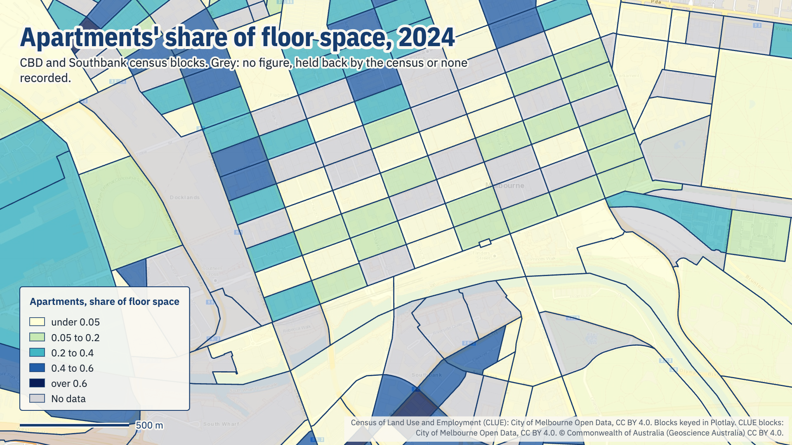
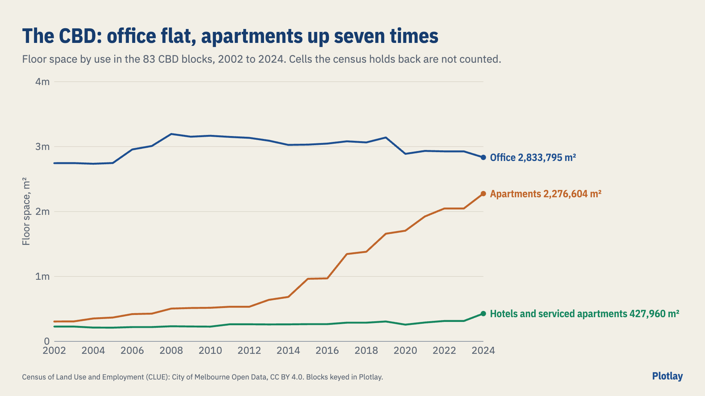
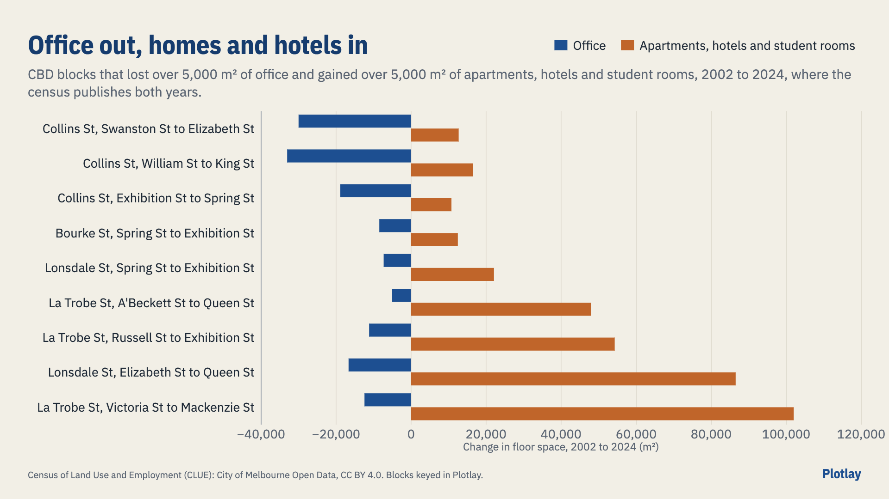

# The CBD changing use

Where Melbourne's CBD office floor space gave way to apartments, hotels and student rooms, block by block, from the City of Melbourne's Census of Land Use and Employment (CLUE), 2002 to 2024. **Live version, with an interactive map:** [getplotlay.com/showcase/melbourne-cbd-use](https://www.getplotlay.com/showcase/melbourne-cbd-use/)



Between 2002 and 2024, apartment floor space in the CBD grew **7.4 times**, from 0.31 to 2.28 million m². Office floor space ended about where it began: 2.75 million m² in 2002, a peak of 3.19 million in 2008, 2.83 million in 2024. Where the census publishes both years, **9 CBD blocks lost over 5,000 m² of office and gained over 5,000 m² of apartments, hotels or student rooms**: 143,008 m² of office out, 365,305 m² in.

The census is a table keyed by `block_id`; the block outlines are a separate file. The shapes here were made in [Plotlay](https://www.getplotlay.com) to join them, and the charts and map pictures were made in Plotlay too.

[](https://app.plotlay.io/?example=melbourne-cbd-use&as=client)

## What the data says

| | 2002 | 2024 |
|---|---|---|
| CBD office floor space | 2,745,609 m² | 2,833,795 m² |
| CBD apartments | 306,545 m² | 2,276,604 m² |
| CBD hotels and serviced apartments | 228,332 m² | 427,960 m² |
| CBD floor space held back by the census | 23% | 13% |



Blocks that lost over 5,000 m² of office and gained over 5,000 m² of apartments, hotels and student rooms (where published):



### Read it carefully

- **Blocks, not buildings.** The census does not say which building changed use.
- **Held back cells stay blank.** The census leaves a cell blank where it would describe two businesses or fewer; each row's total still includes it. CBD totals here are the published cells. A block's change is worked out only where office and apartments are published in both years; hotels and student rooms add where published.
- **Student housing** in the CBD is almost all held back (3,033 m² published for 2024).
- For about half the blocks the 2023 figures are the same as 2022's.

## How it was made with Plotlay

1. **A map project** on the Geoscience Australia base map, and a **Data layer** called Blocks.
2. **Pick from a layer, Take all.** The council's CLUE blocks file: all 603 blocks in one step, keyed by `block_id`.
3. **Link from an address.** The census table from the council's portal, keyed by `block_id`, the census year as the time axis; a second table names each block from the streets round it.
4. **Formula columns**: `office_2002` (`sum(office, year = 2002)`), `office_2024`, `office_change`, the same for apartments, hotels and student housing, and `homes_hotels_students_change`.
5. **Colour** by apartments as a share of floor space through the years; then by office change. **Show in 3D** by floor space per m² of block.
6. **Charts and map pictures** in the Analysis workspace, exported as PNG; the layer exported as GeoJSON, TopoJSON and CSV with WKT. Plotlay's office figures match the census table block for block.

The portal address linked in step 3 is in [`data/README.md`](data/README.md).

## What's here

| Folder | What |
|---|---|
| [`data/geometry/`](data/geometry) | The 603 blocks from Plotlay (key `block_id`): GeoJSON, TopoJSON, CSV with WKT, with the formula columns |
| [`data/clue/`](data/clue) | `floor_space_by_use.csv` (the census columns as linked) and `block_names.csv` |
| [`python/`](python) | A narrated notebook: [`cbd_changing_use.ipynb`](python/cbd_changing_use.ipynb) |
| [`powerbi/`](powerbi) | A Power BI Project (`.pbip`). Start with [`powerbi/OPEN-ME.md`](powerbi/OPEN-ME.md) |
| [`visuals/`](visuals) | The maps, charts and animation |

### Run the notebook

```
python3 -m venv .venv
.venv/bin/pip install -r python/requirements.txt
cd python && ../.venv/bin/jupyter lab cbd_changing_use.ipynb
```

## Sources and licences

- **Code** (notebook, Power BI project): MIT, see [`LICENSE`](LICENSE).
- **Our data** (the shapes, the tables, the charts): CC BY 4.0, see [`LICENSE-DATA`](LICENSE-DATA). Credit "Plotlay (getplotlay.com)" and the sources below.
- Floor space per space use for blocks (CLUE), Blocks for CLUE and Road Segment: City of Melbourne Open Data, data.melbourne.vic.gov.au, CC BY 4.0.
- Base map in the app: © Commonwealth of Australia (Geoscience Australia), CC BY 4.0.

This is independent work using open data, not endorsed by the City of Melbourne. Full credits are in [`NOTICE`](NOTICE).
